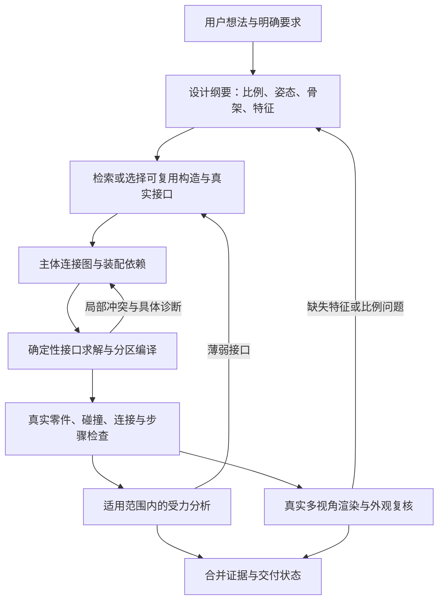

# 复杂积木生成：原因、技术路线与调整建议

本报告记录改造前的调查基线；当前实现和验收见 [技术优化方案](brick-generation-technical-plan-2026-10-22.md)。

日期：2026-10-22。对象：Chimii 当前工作区、Git 基线 `fbc8d166e04ea3918065ca910524f2378ab84c5a`、项目保留的 2026-10-06 验收材料，以及本次检索的原始论文和作者文档。

**判断：需要调整积木生成内核。现有 Go、Next.js、共享前端、任务队列、LDraw/GLB 展示链可以继续使用。优先改变设计的表达方式、生成与校验的配合方式，并补充受力分析。**

当前路线能够把部分合法的结构描述编译为很多块积木，却还不能稳定地从一句话设计出复杂、可辨认、结构合理的装配。这里同时存在生成能力不足、表达范围不足和物理判断不足三个问题。

## 1. 本次分析的证据范围

本次读取了规划器、修复与审查流程、LLM 包装器、目录语义、任务执行代码、历史候选和验收记录；检索并阅读了 BrickGPT、BrickNet、BrickAnything、StableLego、BrickSim 和 LDraw Nova 的一手资料。

发现当前工作区存在 129 个受 Git 跟踪文件的删除状态，涉及 `server/internal/build/`、`packages/core/build/`、`packages/views/build/` 和其他路径。当前命令：

```text
GOPROXY=off GOTOOLCHAIN=local go test ./internal/build -run '^TestCompile' -count=1
stat .../server/internal/build: directory not found
FAIL [setup failed]
```

这说明当前检出无法直接复测 Build 编译器；没有证据说明这些删除是此前长期生成问题的起因，也没有确认生产部署的实际版本。本次保留了现场，没有恢复或覆盖这些文件。

为了核对算法边界，把 Git 中的 Build 包只读提取到 `/private/tmp/chimii-brick-audit-4lia27t_`，在独立、无外部依赖的 Go module 中运行了 5 项既有针对性测试和 2 项诊断探针。另在隔离包中执行了**当前工作区的原始 `DerivePartSemantics` 函数**，检查 1000 种零件清单。

因此，下文明确区分：当前可读的 v4 规划与审查代码、Git 基线中的编译器、历史 v4 成品证据。未重新调用付费生成服务，未访问生产数据库，未重新运行当前产品的浏览器或实物验收。

用户指定的 ChatGPT Classic 已尝试访问，工具返回 `Computer Use is not allowed to use the app 'com.openai.chat' for safety reasons.` 本报告由当前会话完成源码分析和公开网络研究，没有声称经过 Classic 复核。

## 2. 最直接的证据：能编译很多块，与能自动设计是两项能力

项目已经保留了足够具体的失败记录，不能把问题只归因于前端或零件数量上限。

| 项目材料 | 实际结果 | 说明 |
| --- | --- | --- |
| 625 零件、38 构造、166 步场景 | 人工编写结构后编译通过 | 证明该样例的编译与产品展示链可处理这一规模；不是一句话生成的成功案例 |
| 复古巴士的最终复核 | `BUILD_SEARCH_LIMIT` | 在限定搜索中未找到车窗舱的合法支撑铺砖；不等于数学上无解 |
| 展示飞船的最终复核 | `BUILD_REQUIREMENTS_UNMET` | 修复提出普通构造不支持的 `left/right` 侧向连接 |
| 宇航员的最终复核 | 166 零件、56 步，`model_reviewed_not_proven` | 底座占 78 块，主体 88 块；外形粗糙，实际双臂抬起，审查文字却描述为下垂 |

来源：[`fixture-verification.json`](evidence/one-sentence-bricks/fixture-verification.json)、[`authorized-review-verification.json`](evidence/one-sentence-bricks/authorized-review-verification.json)、[巴士日志](evidence/one-sentence-bricks/interface-final-vehicle/run.log)、[飞船日志](evidence/one-sentence-bricks/interface-final-spacecraft/run.log)。本次也实际查看了保留的宇航员和飞船截图。

这些是固定历史候选的记录，不是本次重新测得的成功率。中断恢复、不同规则和不同批次的结果不能混算。

## 3. 六个主要原因

### 3.1 结构表达以体积和上下堆叠为主，真实装配接口很少

当前 [`build_scene_planner.go`](../server/internal/handler/build_scene_planner.go) 第 28—35 行明确约束：

- 普通构造只能接地，或接到同一对象内父构造的顶部。
- 普通构造不能通过侧面接触连接；侧面锚点主要用于嵌入父体积的换色贴片。
- X/Z 使用整数 stud，Y 使用整数 plate；场景朝向为四个水平直角。
- 手臂、尾巴、鼻口等需要下方支撑或选择抬起姿势。

这些限制适合直立、分层的普通砖模型。横向安装的细节、肩部接口、悬臂机翼根部、铰链、侧凸点、夹子、球头和复杂曲面会受到明显限制。普通砖仍能通过交错、搭接做出很多复杂结构；问题是当前没有把这些结构技巧充分固化为可复用的接口能力。

飞船修复失败并非只差一句提示词。模型需要的装配动作超出了当前接口语言。直接给 `anchor` 加上 `left/right` 也不够：还必须有真实零件上的匹配连接器、合法姿态、占位和支撑策略。

### 3.2 1000 种零件的展示目录，只有很小一部分进入自动设计

本次执行当前原始语义函数，得到：

| 清单分类 | 数量 |
| --- | ---: |
| 已评审、允许自动搭建 | 14 |
| 由简单砖/板规则推导、允许自动搭建 | 40 |
| 有基础 tile 语义、未开启自动搭建 | 11 |
| `asset_only` | 935 |
| 合计 | 1000 |

前两项合计 **54 种**，其中 **51 种**满足矩形 stud/tube 铺砖的语义条件。数字来自清单和语义函数，尚未扣除 GLB 边界与占位检查可能进一步排除的零件，也不是对生产数据库有效目录的查询。

依据：[`semantics.go`](../server/internal/ldrawsync/semantics.go) 第 77—129 行；[`starter-kit-1000.json`](../server/internal/ldrawsync/starter-kit-1000.json)。大量斜面、曲面、楔形、特殊板和 Technic 连接件仍属于展示资产。

所以，模型实际可用的“搭建词汇”远少于界面可浏览的零件。单纯扩大模型上下文或渲染目录，无法增加真实可编译的建造技巧。

### 3.3 先一次性生成完整场景，再尝试编译，错误发现得太晚

[`build_planner.go`](../server/internal/handler/build_planner.go) 把构造能力、需求和历史一起发给模型，要求返回整场 recipe。它已经使用相对锚点，减少了绝对坐标计算，但模型仍需同时决定：比例、构造类型、尺寸、上下关系、洞口、颜色、细节归属和可铺砖性。

随后 [`compileAndReviewScene`](../server/internal/handler/build_scene_planner.go) 整场编译，失败时让模型改尺寸、锚点或增加支撑；累计最多两次修复，格式错误也会消耗预算。成功后再做整场文本审查。

这会形成一种反复失败的过程：构造 A 局部看起来合理，等 B/C 接上后才发现高度不兼容、表面被占用、开口不受支持；修复 A 又影响 B 的空间和 C 的外观。修复函数有局部 patch，不等于已经实现子装配独立求解、接口预检和增量编译。

建议保留总截止时间与有限修复原则，把检查前移到每个接口和子装配，降低一次修复需要同时解决的变量数量。

### 3.4 几何铺砖承担了过多结构设计责任

Git 基线中的 `shape-solver.go` 是有界的、按目标单元搜索真实矩形砖的求解器；它考虑支撑、连通、连续接缝与局部重铺。这是一条有价值的确定性链路，但它无法自行替设计者发明梁柱骨架、合适的翼根或肩部装配。

目标体积、颜色、孔洞、特征归属、接缝、先前步骤支撑和零件约束同时收紧时，搜索空间会迅速变差。一处眼部色块或窗洞即可使整场布局卡住。

版本边界必须分清：Git 基线 v3 有 200 零件、24000 节点、8 秒等限制；当前 v4 规划提示支持 1200 零件，项目 v4 验收文档记录整场 96000 节点/20 秒。由于 v4 编译器源码缺失，本次没有把旧参数当作当前 v4 的实际执行参数。

`BUILD_SEARCH_LIMIT` 只证明预算内没找到方案。正确优化方向是先构造可连接的骨架，再求局部表皮与细节，保留已验证的子装配；用失败区域和接口冲突指导有限搜索。用户明确要求的洞口、颜色和功能继续作为硬约束。

内部填充、局部尺度偏好和非关键轮廓，可以作为显式定义的设计自由度；不能把所有外形单元都过早固定，又希望铺砖器自动解决任意结构冲突。具体自由度需要产品规则和回归样例约束。

### 3.5 现有“物理”检查主要是连接、支撑和整体防倾覆

Git 基线中的 `mechanics.go` 有真实连接器匹配、每步连接图、接地支撑凸包以及体积质量近似重心。这些检查有作用，但未建立逐零件受力与力矩平衡，也没有经过实测标定的抗拉、抗剪或扭矩极限。

本次两个隔离探针结果：

```text
连接容量 capacity_units=1：    buildable=true，连接数=2，重心裕度=111
连接容量 capacity_units=1000： buildable=true，连接数=2，重心裕度=111

构造出两个精确连接，其中一个为侧向 stud/receptor：
exact_connections=2，buildable=false，错误为 side 零件 unsupported
```

第一项表明容量字段没有参与该基线的载荷平衡计算；没有据此声称探针模型在现实中一定会断裂。第二项使用合成连接器元数据检查策略边界，表明即使底层识别侧向连接，上层“先前步骤的下方支撑”策略仍会拒绝；它不是对某种真实侧接零件的实物认证。

这解释了两个方向的偏差：可合法侧接的结构难以表达；整体重心在底座内的作品，也未必具有足够的局部接口强度。给模型增加大底座不能证明翼根、肩部或细柱可靠。

历史 v4 成品也保存了 `physics_profile_version=conservative-static-v1`，并把步骤证据写为 `earlier_step_support_and_static_volume_mass`。这些材料与上述能力边界一致，但不能代替对缺失的 v4 源码逐行复核。

### 3.6 成品审查没有看到真实零件渲染，且规划走低推理强度调用

当前审查输入是 recipe、编译摘要、接口诊断和粗粒度正交颜色投影。代码自己说明这不是实际零件渲染。审查调用 `GenerateText`，显式关闭扩展思考；规划和几何修复调用 `GenerateReasonedText`，显式设置 `effort=low`。

本地 `.env` 配置是 DeepSeek V4 Pro，通过 Anthropic 兼容接口；Build 使用独立的 `CHIMII_LLM_*` 服务配置。它没有在这条调用里读取用户为通用智能体选择的运行时模型。没有查询线上环境，因此不把本地配置等同于生产配置。

代码中的 `budget_tokens=2048` 不构成实际推理长度保证。DeepSeek 官方说明该兼容接口忽略 `budget_tokens`，通过 `output_config.effort` 控制强度。应分任务设置与评测规划强度，记录实际 token、耗时和失败类别。不能通过统一改大超时或思考强度来代替结构表达的调整。[兼容接口文档](https://api-docs.deepseek.com/guides/anthropic_api/)、[推理模式文档](https://api-docs.deepseek.com/guides/thinking_mode/)

## 4. 全网研究对本项目的启示

以下是阅读原始材料后的判断；本次没有安装、训练或运行这些外部系统。

| 参考 | 值得借鉴的能力 | 必须保留的边界 |
| --- | --- | --- |
| [BrickGPT](https://avalovelace1.github.io/BrickGPT/) | 稳定结构数据、逐砖合法性检查、失败回退和重新生成 | 专用任务与受限砖库，不能直接等价为任意复杂产品设计器 |
| [BrickNet，2026](https://arxiv.org/html/2604.22984v1) | 连接图驱动的程序表达，把“连接哪里、用什么接口”作为建造描述 | 原论文将序列限制到 100 件；长序列碰撞仍是明确难点，图表示本身没有解决全部几何问题 |
| [BrickAnything，2026](https://arxiv.org/html/2605.26182v2) | 由几何条件生成结构，显式局部装配依赖、合法性约束和回退 | 论文评估域为 20×20×20 和 8 种标准砖；适合受限雕塑路线实验，不能直接承担开放零件装配 |
| [StableLego](https://arxiv.org/html/2402.10711v2) | 用质量、接触力、力矩和摩擦能力评估受力与薄弱部位 | 模型有刚体、连接已充分扣合等假设；参数需要匹配实际零件，计算结论与实物结论分别保存 |
| [BrickSim，2026](https://arxiv.org/html/2603.16853v1) | 专门处理 snap-fit 连接、内部受力与断裂，补充普通刚体引擎 | 论文的实物对照主要是至多 30 块；实时范围小于 50 块。当前仓库要求 Linux/NVIDIA 环境，不适合立即搬进每个 1000 件在线生成任务 |
| [LDraw Nova](https://github.com/anteloc/ldraw-nova/blob/master/docs/agent/complex-models.md) | 可复用模块、局部坐标、接口合同、生成—检查—渲染—修订 | 作者的[校验说明](https://raw.githubusercontent.com/anteloc/ldraw-nova/master/docs/agent/validation.md)明确区分解析、几何、连接覆盖和实物证据；默认全场连接检查有规模边界 |

最有价值的新信息是 BrickNet 的连接图表达，以及 BrickSim 对专门连接力学的建模。我的推断是：Chimii 应借鉴前者改进生成语言，借鉴后者和 StableLego 建立受力对照；继续保留自己的版本化目录和最终编译检查。

普通刚体引擎可以用于动力学，但积木的卡扣/过盈配合需要专门模型。给 Three.js 场景加上重力，不能直接补齐夹持力、装配插入和拆解问题。BrickSim 的论文专门讨论了这一差别。

现有图片/网格到体素路线可以作为动物、人物和雕塑的候选来源。它提供轮廓与颜色条件，后面仍需经过结构设计、真实选砖和统一校验；不应为了增加画面复杂度而复制一套独立且验收标准不同的生产编译链。

## 5. 建议的目标架构

继续使用现有队列、不可变 creation、目录版本和最终 validator。让模型选择设计策略与构造能力，让确定性程序计算真实变换、连接、铺砖和装配约束。



这不是增加多个自由聊天智能体。可以使用现有服务中的有界状态机和工具调用来实现，避免引入另一套任务、权限和状态系统。

### 构造库应保存什么

先复用已经存在的 `storey`、`platform`、`frame`、`wheelbase` 等能力。每个可复用构造补齐：局部坐标、实际零件清单、参数可行域、接入端口、端口占用区域、合法朝向、局部步骤、目录版本和验证证据。

从普通砖的交错墙、过梁、双层搭接板、翼根、躯干肩部等结构技巧开始，再按产品需求增添少量侧接或特殊连接件。构造库服务多种主题；不需要为每个用户想搭的物体编写一个完整模板。

### 连接图应表达什么

把“这个翼部接到哪个机身接口”保存在结构数据中，而不只保存在 `label=左机翼` 或需求索引中。接口要落到真实 placement/connector，包含类型、配对方向和占用规则。

模型提出配对关系和有限参数，编译器解出变换。自由的 `left/right` 文本不是连接证据。经审核的特殊连接需要同步扩展姿态、碰撞和支撑策略，而非只增加枚举值。

区分主体功能构造和展示支撑，并指定哪些主体接口必须直接存在。不要普遍要求所有展示品移除支架后独立站立；也不能让一对接在底座上的独立柱子通过标注冒充连接到躯干的双臂。

### 局部求解与修复应怎样工作

先验证骨架和接口，再编译主体大体积，最后增加表面细节。每一步保存已经通过的子装配；失败时返回冲突接口、目标区域、候选数量和预算停止原因，只让模型修改受影响的设计变量。

现有局部重铺算法继续复用。只有测量显示局部离散搜索成为主要瓶颈时，再评估用约束规划或整数优化替换该局部任务。保持同一份目录、碰撞和连接验证入口。

### 受力分析分阶段补充

第一阶段为选定普通砖增加有来源的质量与重心，建立小结构的准静态对照。对每个零件检查力与力矩平衡，并对接触与卡扣作用施加可标定的能力约束。先作为独立评测，不直接成为未经校准的上线“安全证明”。

第二阶段用薄弱接口指导梁、连接面和局部重铺。求解超时、类型不支持或数据不足都记录为无结论。

第三阶段在产品需要移动、跌落、装配动作时再评估动态仿真。装配插入空间、手部/工具可达性也需要单独检查；最终姿态不碰撞不能证明零件按给定顺序放得进去。

### 外观复核的输入应改变

使用最终真实零件渲染的前、后、左右、俯视、底视图；机翼根部或肩部等关键接口增加近景或剖视。审查输入绑定模型内容哈希和用户需求。

视觉模型判断轮廓、比例、颜色和特征可见性，几何程序判断空间与接口，受力模型判断其支持范围内的载荷问题。继续沿用当前区分算法检查与实物验证的产品文案。

## 6. 实施优先级与可验收结果

| 顺序 | 工作 | 交付与验收 |
| --- | --- | --- |
| P0 | 核对并恢复完整的编译器源版本；冻结可复现基线 | handler、compiler、schema、目录及实际服务版本一致；先把当前缺失源码和未提交实现的版本问题处理清楚 |
| P1 | 固化已有通用构造的可行域和真实端口，补少量关键结构技巧 | 人工结构基准包含多层交错墙、洞口过梁、双柱桥、车身窗框、翼根、人物躯干与双臂；每项有正例和明确反例 |
| P2 | 从整场一次输出转向骨架/接口先行、子装配增量编译 | 同一模型与预算下比较首轮通过率、有限修复后的需求保留率、外观质量和耗时；所有失败保留 |
| P2 并行验证项 | 调整 Build 独立模型策略，做 low/high 等受控对照 | 分离模型能力、提示/表示、编译器三种影响；记录实际服务参数，避免只根据 UI 模型名称判断 |
| P3 | 真实多视图外观复核；普通砖小结构受力对照 | 视觉不再只读粗占位；受力有适用零件、边界条件和无结论状态 |
| P4 | 代表作品实物拼搭，再扩大规模和零件范围 | 记录步骤可执行性、局部脱落、悬臂、搬动与重复装配情况；复杂功能另设验证 |

起步基准不必马上追求 1200 块。先验证 10—30 块的多层、跨接与明确连接规则，再验证 100—300 块的主体设计，随后才扩大到更高规模。零件总数、主体零件数、有效接口与特征细节分别统计，避免底座和重复堆叠抬高“复杂度”。

模型评测可先复用现有五类题，稳定后扩展到每类不同体量、比例和功能的固定请求。重复运行要固定版本、参数、预算和验收口径，不把不同代码版本的最好一次拼成成功率。缺件按当前 v4 的建议清单语义处理，不在设计阶段冻结或扣减用户库存。

## 7. 本次已执行验证与结论边界

本次结果与源码哈希保存在 [`audit-results.json`](evidence/brick-generation-review-2026-10-22/audit-results.json)；[基线诊断探针](evidence/brick-generation-review-2026-10-22/audit_probe_test.go.txt)与[目录语义探针](evidence/brick-generation-review-2026-10-22/semantics_audit_test.go.txt)以文本保留，不加入产品测试入口。

- 当前工作区 Build 测试：**无法启动**，原因是核心目录缺失。
- Git 基线独立快照：5 项既有针对性测试通过，覆盖基础编译、精确连接、防倾覆凸包、无语义零件拒绝和桥梁搜索。
- Git 基线诊断：2 项探针通过，确认容量字段不参与载荷计算、侧接与下方支撑策略不一致的范围边界。
- 当前目录语义函数：1000 项清单实际执行，结果为 14/40/11/935，矩形铺砖候选 51。
- 外部论文与项目：本次网络阅读，未实跑它们的模型或求解器。
- 真实一句话生成、当前浏览器、生产部署、实物拼搭：本次未执行。

建议保留应用框架，把下一轮开发集中在“可复用真实构造 + 主体接口图 + 增量编译”这一条主线上，同时建立受力与实物对照。提高零件上限、统一延长超时或更换聊天模型，均应通过同一基准判断收益。
