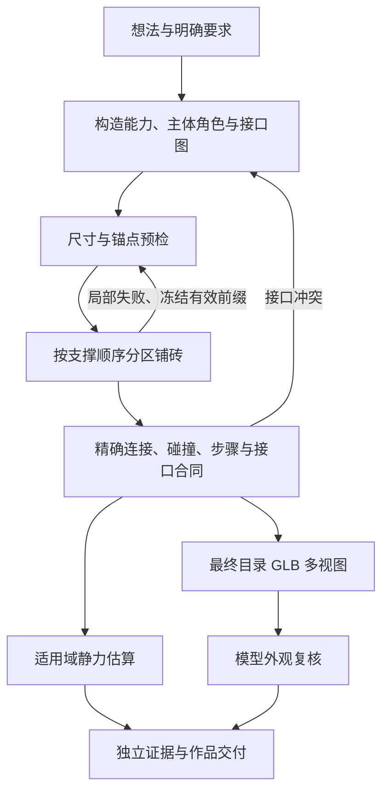

# Chimii 积木生成架构与技术优化方案

日期：2026-10-22。依据：[架构审查](brick-generation-architecture-review-2026-10-22.md)。本方案同时作为实现与验收清单。

## 1. 复核后的决策

保留 Go 编译器、版本化目录、PostgreSQL 租约队列、不可变作品和共享 Web/Desktop 视图。生成质量由明确的结构数据与确定性检查共同提高。模型负责选择结构与参数，程序负责坐标、连接、几何、求解预算和证据。

上一份审查需要补充两点：连接容量字段未参与计算，只能说明缺少载荷模型，不能据此判断某个模型必然倒塌；受力优化、动态仿真和实物验证也不能合并为同一项“物理通过”。因此本轮分别实现装配合同、增量编译、真实几何视图和有适用范围的静力估算。

复杂度优先通过普通砖的搭接、交错与可复用构造实现。当前没有经审核的侧接零件时，不增加虚构的侧向锚点；后续扩展特殊零件须连同姿态、占位与装配规则一起评审。

## 2. 源码恢复与基线

缺失目录中的 v4 实现尚未完整进入 Git。通过读取原开发会话的压缩记录，在临时目录重放纯文件补丁与受限的字符串修改，恢复构造、锚点、需求检查、前端解析和展示。没有执行历史中的数据库、网络、发布或模型命令。

恢复先在隔离 Go module 执行原编译器测试，再仅复制当前缺失的文件；已存在的代码和修改保留。恢复过程及文件哈希保存于 `/private/tmp/chimii-before-brick-optimization/restoration.json`。原工作区差异已备份，后续优化以恢复的 v4 为基线。

## 3. 数据契约

沿用 `AssemblyRecipe.version=4`，新生成使用 `SceneSpec.version=2`。已有 v1 场景仍可读取、编译与继续修改；新生成入口要求 v2。

### 构造与主体接口

`Construction.role` 使用 `subject`、`structure`、`detail`、`display_support`，表示设计职责，不声明力学认证。

每个 `SceneObject.interfaces` 包含：

```json
{
  "id": "left-shoulder",
  "a": "torso",
  "b": "left-arm",
  "minimum_connections": 1
}
```

接口只能引用同一对象内存在的非换色构造。ID 和端点唯一，数量有界。主体通过非展示支撑的接口图连接，避免把底座上的独立柱子标成手臂或机翼。展示支撑可以承载作品，作品不必移除支架后独立站立。

实际接口证据来自最终 placement、目标单元归属和精确 connector 图。一块真实砖可以跨构造边界；这种情况下记录真实共享零件，不能仅按铺砖器的单一 `Module` 归属误判断开。连接数量不解释为承载强度；一块跨界砖和它向任一侧的内部连接不会重复计数。

`BuildEvidence.interfaces` 保存端点、真实连接和跨界零件证据。合同未满足时返回明确的构造接口错误；不通过改标签或删除要求修复。

### 兼容与不可变性

所有新增响应字段在前端通过 Zod 解析，旧作品缺少字段时保留原有展示。未知可选检查结果不能使整件作品消失；畸形数据测试覆盖新增字段。recipe、plan、目录版本和内容哈希仍共同确定作品，进度写入不修改这些数据。

## 4. 生成与编译流程



### 有界增量求解

沿用 `shapeSearch` 和原最终校验器，按水平支撑前沿编译局部目标，冻结已验证的低层零件。水平分区保留同层跨构造搭接能力，避免逐模块孤立铺砖造成无法交错连接。

所有分区与重试共享一次编译的 96000 搜索节点与 20 秒上限，单对象 800、整场 1200 零件等限制保留。局部阶段允许暂时独立且接地的构造，最终必须通过整件连接与接口合同。

仅在同一次生成/有限修复中复用前缀缓存。键包含目录内容、固定零件及累计目标几何、颜色与归属；上层调整可复用下层，底层或目录改变必须失效。缓存不进入用户库存，不通过数据库保存可变作品，不进入模型输入。

失败输出记录对象、前沿、涉及构造、已完成前缀、搜索节点与停止原因。`BUILD_SEARCH_LIMIT` 不解释为不可搭建。原两次模型修复上限和租约检查继续执行。

## 5. 模型策略

Build 使用自己的任务策略，通用标题/摘要调用保持原行为。规划和几何修复的推理强度可独立配置；对所配置提供方支持的取值做校验，记录实际模型和请求参数。

新规划提示只要求选择现有构造、主体职责、真实锚点和必要接口。输入还包含当前目录的自动拼搭零件数、最长矩形零件与固定柱网跨距能力，避免用仅能展示的资产充当梁；备用 10 零件目录不宣称具备完整楼板柱网所需的长梁。构造可行域由程序预检，不把完整铺砖过程交给模型。修复继续采用受保护的 patch，身份、颜色、洞口、功能与需求保持。

真实视图审查使用图片 ContentBlock 与编译诊断，批准绑定用户需求、内容哈希、审查策略和渲染版本。供应商不支持图片、资产缺失或渲染超时必须明确失败或返回未复核状态，不伪称视觉检查通过。

## 6. 真实几何视图

复用当前目录编译的 GLB。实现受限的服务端软件渲染：只接受项目 GLB 编译器输出的三角面、材质和内嵌 buffer 格式；拒绝不支持的结构。按当前 placement 变换和 LDraw 颜色组合零件，深度缓冲消除遮挡。

生成前、后、左、右、上和等轴视图；每张尺寸、三角面数、总像素与截止时间有界。统一使用同一模型边界和尺度，记录图片哈希与渲染版本。不同目录版本不共享几何缓存。

这提供真实表面证据，不执行任意生成代码，不引入浏览器或 GPU 服务，也不取代物理判断。

## 7. 受力估算的适用范围

先实现普通直立 stud/tube 砖、重力工况下的有界准静态估算。使用有明确来源的标准砖质量；接触点沿真实 connector 配对建立，接地仅提供压缩反力，不默认存在粘住零件的隐形底板。

求解每块砖的竖直力与两个倾覆方向力矩平衡；卡扣拉力受显式参数约束。结果描述为该模型下的估算，保留质量来源、参数、适用范围和数值残差。水平外载、扭转、弹性变形、磨损、插接过程及未知零件均不由此认证。

采用小规模、有截止时间的线性可行性求解。超规模、未知质量、未知接口和超时返回 `not_evaluated`，不视作稳定。先做解析结构和已知小结构对照，不以未经实物校准的估算替代现有生产判定。

动态仿真和实物试搭是后续独立验收，不能由本轮软件测试宣布完成。

## 8. 验收矩阵

| 范围 | 必须验证 |
| --- | --- |
| 源码基线 | 恢复后 build/buildeval/ldrawsync/llm 测试及 core/views 类型检查 |
| 接口合同 | 同底座假连接拒绝；真实直接连接通过；跨界砖被识别；端点、重复、图与上限错误拒绝 |
| 增量铺砖 | 多层、洞口、桥梁、颜色、轮组；取消与预算；缓存命中及目录/低层变化失效；最终验证一致 |
| 模型调用 | 新场景必须包含角色与合同；旧场景可读；修复保护字段；推理参数和图片实际进入请求 |
| GLB 渲染 | 坐标/朝向/颜色/遮挡；真实目录资产；缺失/畸形 GLB 拒绝；可重复哈希与截止时间 |
| 受力估算 | 自由落地、受压堆叠、悬臂、拉力极限、无地支撑；未知质量和超限无结论；数值残差 |
| 前端与接口 | 新证据解析及畸形响应；已有作品、BOM、进度和新作品展示 |
| 应用闭环 | 隔离数据库、固定模型夹具及真实 GLB 的浏览器流程；与真实提供方生成结果分别记录 |

实现与测试过程中如发现本方案假设不成立，在本文件记录调整及理由，不通过降低需求或校验标准取得通过。

## 9. 本轮交付与验收

已在工作区实施第 3–7 节的功能，未提交、推送或部署。新增证据保存在 [验收目录](evidence/brick-generation-optimization-2026-10-22/)；[机器可读结果](evidence/brick-generation-optimization-2026-10-22/test-summary.json) 区分完整单测、定向集成、显式跳过、浏览器和真实提供方。

### 代码入口

| 能力 | 实现 |
| --- | --- |
| 主体接口和证据 | `server/internal/build/assembly-graph.go`、`scene.go` |
| 水平前沿与有限缓存 | `scene-incremental.go`、`shape-solver.go`、`shape-repair.go` |
| 目录实际能力 | `scene-catalog.go`、handler 的规划/修复输入 |
| GLB 六视图 | `scene-render.go`、`server/internal/handler/build_scene_review.go` |
| 独立推理与真实图片 | `server/pkg/llm/content.go`、`build_planner.go`、`build_scene_planner.go` |
| 参考重力估算 | `static-load.go`、`linear-feasibility.go` |
| 解析与展示 | `packages/core/build/{types,schemas}.ts`、`packages/views/build/components/build-scene-details.tsx`、四种语言文案 |

### 验收结果

| 范围 | 结果与边界 |
| --- | --- |
| 完整 Go 单测 | build 66 项顶层测试 / 101 个测试及子项通过；buildeval 6 项、llm 10 项通过；ldrawsync 8 项通过，2 项因要求锁定归档而显式跳过 |
| 后端定向集成 | handler 53 项顶层测试 / 63 个测试及子项通过，5 项按真实模型/外部归档开关跳过；使用独立 PostgreSQL 18，真实应用迁移全部通过 |
| 接口合同 | 拒绝共用底座的假主体连接；识别跨界砖；避免同一跨界砖重复贡献接口数量；缺失端点/断开图拒绝；最后的接口调整已单独回归通过 |
| 增量求解 | 低层冻结、上层编辑缓存复用、低层/目录变化失效、预算共享和取消通过；连续基础必须先形成交错连接，不能冻结成独立砖柱 |
| 真实视图 | 实际目录 GLB 的 0/90/180/270 度姿态、前后遮挡、颜色、PNG 与确定性哈希通过；修正审查/页面的橙色和深棕褐色差异，15 色跨端一致性通过；缺失/畸形资产拒绝；6 张 PNG 确实进入模型请求夹具；渲染版本/图片证据缺失使旧批准失效 |
| 受力估算 | 已知受压堆叠、悬臂在不同卡扣参数下的差异、无地支撑、未知质量、取消、线性系统解析例和非有限数值通过；未做实物校准 |
| TypeScript | core、views、Web、Desktop 类型检查通过 |
| 前端单测 | core 6 文件 / 23 项；views 10 文件 / 39 项通过。一次高并发初跑超时，定向及完整 2-worker 复跑通过 |
| 真实浏览器 | 102 零件 / 25 步角色与 291 零件 / 60 步两层小屋各通过桌面 1440px、手机 390px 验收；BOM 总数正确、真实 GLB 加载、步骤 1/2 保存、无横向溢出及未捕获页面异常 |
| 生成成功率 | 上述两件作品为手工定义的固定场景，不能算 AI 生成成功。另已完成获授权的 DeepSeek 建筑/人形真实测试与同题低强度对照，完整交付为 0/2；低强度人形编译出 55 块 / 40 步，但图片审查超时。详见第 10 节 |
| 尚未执行 | 生产部署、Desktop 安装包、动态仿真、实物试搭、真实零件/颜色采购可得性 |

pnpm 本轮因无法联网验证包管理器签名而拒绝启动。类型与单测通过工作区已安装的 tsc / vitest 执行，没有关闭签名校验。Go 缺失的锁定依赖下载到临时缓存。临时 Web 副本用于浏览器验收，避免改动原应用生成配置。软件 WebGL 留有 ReadPixels 性能警告，跳转中有一次使用量上报取消；无未捕获页面错误。

### 零件目录的可复现性

备用 10 种零件没有小屋楼板需要的长梁，完整小屋在该目录下耗尽搜索预算；相同场景使用经审核长砖的目录可编译为 291 块。这一观察不能推广成“扩大目录一定提高生成成功率”，但证实了目录可用性与搜索失败必须分开诊断。

本次从官方 `complete.zip` 下载的 SHA-256 为 `f3e496d0ede69ca7942fa4aa198e661ee2d22723906101e2e339d8917a4dd5f2`，与项目锁定的 2026-08 归档不同。官方更新页把完整库链接放在最新版本下，并提供历史增量包：[官方目录更新记录](https://library.ldraw.org/updates)。因此只通过 CLI 的显式 archive/hash/release 参数，在独立验收数据库创建 `ldraw-official-acceptance-2026-10-22-f3e496d0ede6-r2`，同步前 100 种真实资产；**没有修改生产锁、替换旧资产或迁移用户作品**。

部署前应把项目原始锁定归档保存在受控、按 SHA-256 寻址的存储中；升级目录需要生成新版本、完成语义与资产回归，再激活。不能把滚动更新 URL 当作不可变制品，也不能为通过校验而覆盖旧哈希。

### 后续验收顺序

1. 用户已明确授权的建筑/人形真实测试及一次同题强度对照已完成；后续使用保存的真实候选作为回归，先完成结构输出与生成约束优化，再做有界实测。失败保留原始要求与每次修复，不换成人工方案作为通过。当前官方 Messages 兼容文档支持 base64 图片，并说明 `budget_tokens` 被忽略：[提供方格式说明](https://api-docs.deepseek.com/guides/anthropic_api/)。真实支持、延迟与输出质量仍以实测为准。
2. 通过后扩到建筑、车辆、飞船、动物、人形的固定语料，分别统计规划可用率、编译成功率、接口通过率、图片复核通过率、用户辨认率和延迟。样本量与难度固定，再比较本轮方案和原版本。
3. 受力估算扩展前先补充零件质量与连接测量，校准接触模型，并与可信求解器及实物对照；当前 32 普通砖范围外返回未评估。复杂作品不因低层几何通过而得到承重认证。
4. 侧接、任意姿态、活动机构和动态仿真分别评审，连同资产、占位、连接、装配步骤及故障样本进入目录。后续算法可在冻结前沿处增加有限回退，须用固定困难样本验证，而非仅提高上限。

本轮结论是“核心软件改造及本地工程验收已完成，真实生成两例尚未完成交付，实物质量未验证”。实测没有证明复杂作品生成问题已解决。


## 10. 获授权的 DeepSeek 真实测试

测试目的地为用户明确批准的 `api.deepseek.com`，实际模型与认证查询返回 `deepseek-v4-pro` 可用。使用独立数据库中的同一 100 零件目录；没有操作生产数据库，没有新增题目。先执行高强度默认配置，再对相同两条提示执行一轮低强度对照。共 7 个生成 HTTP 请求，保持规划 120 秒、纠错/修复/图片审查 90 秒及原有修复上限；之后只做本地重放。

[完整机器记录与原始输出](evidence/brick-generation-optimization-2026-10-22/live-deepseek/evaluation.json)。记录只保存公开测试提示、返回的文本方案、候选、时序和图像，不保存凭据或私有思考内容。

| 配置 | 建筑 | 人形 |
| --- | --- | --- |
| 高推理强度 | 规划 120.01 秒超时，无完整方案 | 规划 120.01 秒超时，无完整方案 |
| 低推理强度 | 103.06 秒返回方案；编译耗尽 96,000 节点，随后修复请求 90 秒超时；总计约 195 秒 | 115.75 秒返回初稿，缺少 kind 字段；77.63 秒完成格式纠正；编译为 55 块 / 40 步，五个主体接口通过并生成六视图；图片审查 90 秒超时，总计约 283 秒 |

**完整交付 0/2。低强度下可编译候选 1/2，不能等同于成品通过或普遍成功率。**

### 定位结果

- 认证模型列表查询 HTTP 200，用时约 0.16 秒；无凭据 HEAD 在约 0.084 秒得到 401。低强度生成请求的连接在 0–32 ms 就绪、首字节在 91–129 ms 返回，HTTP 200 后等待完整响应花费 77–116 秒，另两次在 90 秒取消。证据指向供应商完整响应等待，不能解释为断网或密钥无效；也不能仅据此区分排队与推理耗时。
- 建筑原始方案的失败点是 `main/lower (8,13,22)`、Y<24 前沿。在临时 Go overlay 中，用相同目录、目标、颜色、物理检查和 96,000 节点预算改为整体求解，仍耗尽预算。该实验没有改变生产算法；它说明不能把此例简单归咎于新增分层冻结，也不能据此判定几何绝对无解。
- 人形第一次 JSON 缺少全部构造的 kind；格式纠正保留原始主体与需求后补齐了 solid/paint。真实候选成功编译，之后进入六图审查，审查未完成而未获批准。原始候选与本地重放的内容哈希及六张图片哈希完全一致，未以人工模型替换。
- 人工观察：[人形正面](evidence/brick-generation-optimization-2026-10-22/live-deepseek/figure-front.png)、[等轴视图](evidence/brick-generation-optimization-2026-10-22/live-deepseek/figure-isometric.png)更接近简化的举臂机器人，胸前面板偏侧。55 零件、连通接口和可编译状态不足以证明高复杂度宇航员造型成功。其零件数也超出参考受力模型，受力结果仍为未评估。

### 根据实测已调整

撤回“默认提高到 high”的配置，恢复规划/修复默认 `low`，同时保留独立配置；这是一项保守的延迟选择，不是低强度质量通过的结论。DeepSeek 文档中 medium 实际映射到 high，不能把 medium 当作有证据的中间档：[官方强度映射](https://api-docs.deepseek.com/guides/thinking_mode/)。

补充 opt-in 实测的连接、请求写出、首字节和结束时序；生产 GenerateContent 的失败也记录任务、模型、强度、图片数、耗时和是否触及时限，避免只在成功时留下指标。新增日志不记录提示、图片、凭据或思考内容。调整后 handler/llm 本地回归通过。

### 下一轮优化的具体优先级

1. **约束结构输出**：把 kind、role、接口端点和 attachment 形式纳入受约束的生成契约；选择提供方确实支持的工具/结构输出模式并验证，不能只假定 JSON 模式保证所有必填字段。字段纠错应尽量局部，避免每次重新生成整份大 JSON；不得自行补造身份特征或放宽合同。
2. **在生成前收紧可行域**：普通砖优先使用可组合的高度、开口和梁/柱参数；把参数关系、锚点中心偏移与前面板对齐变成可选的确定性约束。对本次真实建筑候选做局部搜索、候选排序和有限回退对照，保留原目标，不直接提高全局节点数。最大零件长度只是必要目录条件，不能替代具体断面的可铺设性检查。
3. **按任务配置模型与输出预算**：规划、简单字段纠正、几何修复和图像审查不必使用相同策略。先用上述相同题目评估结构质量与延迟，再决定是否分配不同模型、输出上限与异步阶段；当前证据不足以宣布换模型即可解决。`budget_tokens=2048` 仍不能作为 DeepSeek 实际推理时长上限。

生产部署、扩大真实语料和实物试搭继续作为独立验收门槛。本轮实测的价值是暴露交付失败位置并修正默认策略，而非把局部编译成功写成整体问题解决。
