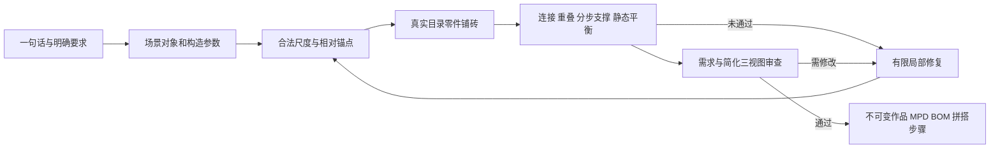

# 一句话生成复杂积木：参考项目、实施结果与优化路线

更新：2026-10-06。本次范围是建筑场景、车辆/飞船、动物/人物；系统选择尺度、配色和支撑姿态，用户指定的特征仍然优先。库存用于补件建议，不限制新场景设计。

## 1. 结论

主参考应是 **ldraw-nova 的设计、构造复用、渲染检查循环**。Brickify 适合借鉴体素铺砖、配色和完整交付，并作为将来的图片/网格输入路线。BrickGPT 适合借鉴拒绝、回退和离线比较。

当前 Chimii 已加入 v4 构造场景、目录零件编译、有限修复、需求审查、零件清单和大模型渲染。但**尚未达到所有类别稳定的一句话生成，更未证明实物可靠性**。人工构造样例通过编译，不能代替真实文本生成验收；AI 说“通过”也不能代替可见特征或实物试搭。

## 2. server 中三个项目的适用范围

| 项目 | 当前代码实际路线 | 最值得参考 | 主要限制 |
|---|---|---|---|
| ldraw-nova-master | Agent 规划子模型、查零件、生成脚本/MPD、渲染、检查、迭代 | 子模型边界、构造库、连接锚点、检查与局部修订；最接近复杂建筑与交通工具设计 | 本地源码是 AGPL-3.0；本次独立实现其工作流思想，没有导入其实现。README 自述大模型成本、生成效率及动物/人物等家族仍有不足 |
| brickify-main | 图片经过外部 image-to-3D 得到 GLB，体素化、铺砖、连接修补、清单/动画输出 | 表面颜色与内部结构分离、错缝、BOM、LDraw 与可复核报告 | 不直接解决一句话的设计理解；填充、桥接、加柱可能改变造型；修复未完成仍会输出最佳候选 |
| BrickGPT | 生成基础砖位置，用拒绝/回退和可选优化器检查结构 | 有限候选搜索、拒绝不合格结果、统一实验集 | 基础砖种有限，Gurobi 等依赖并非所有运行路径具备；不能把可选物理检查当成所有结果的保证 |

不是把任一项目整体替换进 Chimii。现有 Go 队列、目录、编译器、连接/重叠/分步检查和不可变作品应继续承担正式交付。

## 3. Brickify 的主要功能与代码证据

1. `pipeline/image_to_3d.py`：输入图片，调用外部 Hunyuan/Trellis 路线生成 GLB。源码没有完整的文本设计规划器。服务价格、生成时长和上游质量本次没有复测。
2. `pipeline/brickify.py` 的 `load_and_voxelize`：按积木横向 8 mm、纵向 3.2 mm 的分辨率采样网格，尺度由目标高度决定。默认保留最大网格分量，可能丢掉独立细节。
3. `palette_colours`、`fill_interior`、`smooth_colours`：匹配积木颜色、控制颜色数量、填充内部和减少颜色噪声。适合雕塑类模型；精确胸口、眼睛或车灯颜色需要额外特征约束。
4. `pack`、`pack_sheet`：逐层分配砖和板，交替方向并惩罚连续缝。适合大体量体素铺砖，没有证明所有复杂插接或侧向结构。
5. `connectivity`、`find_bridges_layer`、`repair_floating`：查接地连接、尝试跨缝板、向下加支撑柱。`centre_of_mass` 是简化静态检查；它们不证明手能伸进去安装、离地悬臂强度或零件夹持力。
6. `assign_steps`、`write_ldraw`、`write_lists`：输出分步 LDraw、CSV、BrickLink wanted XML。`make_viewer.py` 与 `render_video.js` 输出网页装配展示和视频。

关键问题在 `brickify.py` 的 14 次修复循环：保留浮空数量最少的候选后，无论浮空是否归零仍继续导出。因此应借鉴算法，并在 Chimii 保持“未通过正式校验不保存为可搭作品”的门槛。README 中 1940/4358 零件是上游例子，本次没有重新生成或实物验证。

本地源码入口：

- [Brickify 管线](/Users/chunjun/Desktop/Build/Grow/chimii/server/brickify-main/pipeline/brickify.py)
- [图片到 3D](/Users/chunjun/Desktop/Build/Grow/chimii/server/brickify-main/pipeline/image_to_3d.py)
- [Nova 工作流说明](/Users/chunjun/Desktop/Build/Grow/chimii/server/ldraw-nova-master/README.md)
- [Nova 构造/锚点规划](/Users/chunjun/Desktop/Build/Grow/chimii/server/ldraw-nova-master/ldraw_tools/builder.py)
- [BrickGPT 拒绝与回退](/Users/chunjun/Desktop/Build/Grow/chimii/server/BrickGPT/src/brickgpt/models/brickgpt.py)

## 4. 本次已落地的链路

- **构造场景**：新想法使用 `AssemblyRecipe v4`。场景可含多个独立落地对象；每个对象仍必须自身连接。提供实心体、墙、可带四面窗洞的围墙、楼梯、阶梯屋顶/收缩体、椭圆、局部布尔造型、内嵌颜色贴片和真实四轮底盘。类别是设计意图，不是固定狐狸/汽车模板。
- **自动尺度**：生成阶段为过梁、窗柱、阶梯和屋顶补足最低尺寸，保留开口和颜色。正式编译与 API 输入保持严格。没有指定零件数量时不套用旧版默认 80 块；明确数量仍是约束。
- **相对锚点**：普通构造接地或接父构造顶部，多父支撑须同高；父构造须在同一对象。完整相对锚点图先检查孤立连接组，实际连接仍须编译验证。侧面只允许在已有体积内换色，不能伪造侧向连接。面部标记必须露在指定表面；同一父构造上的不同同色标记保留一单元间隔，放不下时拒绝，不能藏到内部。坐姿、抬臂等仍受实际支撑约束。
- **可信交付门槛**：已有真实连接、占用重叠、按步骤支撑及体积质量近似重心检查继续生效。不填窗洞来强迫通过，不把浮空肢体拆成独立对象逃避检查。
- **可检查需求**：已标注要求中的白色不会由蓝色替代；双臂/双腿至少需要两个实体构造，重复标注不能冒充两个；楼梯需要楼梯构造；窗户需要真实开口；车轮需要底盘，明确四轮只能有一个四轮底盘。这只是有限词汇与构造规则，不能证明任意语义、位置或视觉相似度。
- **目录一致性**：自动铺砖剔除实际 GLB 横向边界、底面高度与占用/连接定义不一致的矩形零件。没有修改生产目录或项目固定的官方归档哈希。
- **局部修复**：保留原对象、ID、需求和特征。最多两次修复，错误 JSON 修正也计入预算；修复预约与方案均在现有队列租约下保存。恢复时要求模型内容、原始请求、主题、说明、明确要求及约束均相同，才复用审查；改了需求但没改模型也需要重新审查。
- **库存与清单**：新场景使用不限数量的设计库存，不冻结、不扣减；显示按当前积木盒计算的缺件，读取失败则保留生成时的建议。BOM 逐零件/颜色计数并可导出 CSV。旧 v2/v3 API 保留原数量约束。
- **产品展示**：数百零件用批量实例渲染，保留零件真实几何、边线、步骤与高亮；目录 GLB 请求携带登录和空间上下文。设计说明、检查依据、零件清单和保存进度已接入现有作品页，四种语言同步。修复了 Go 新场景输出空旧模块为 null 时前端拒绝读取的兼容问题。

场景上限是 8 个对象、64 个构造、1200 零件，每对象 800 零件，32768 目标单元；单次编译共享 96000 搜索节点/20 秒。这些是明确边界，不是稳定生成 1200 块的证据。工作执行上限 540 秒，租约 570 秒，模型调用和修复仍受整体截止时间约束。

## 5. 验收证据

### 本地编译和应用闭环

- 五类人工构造样例全部通过编译；另有窗洞两层围墙样例，检查真实窗洞、窗柱、过梁、楼梯、楼板和屋顶。
- 五类组合样例先在测试目录得到 558 零件，再用隔离库同步的真实目录编译为 **625 零件、38 构造、166 步**。计数变化来自可选目录零件变化。
- 所有使用零件的 GLB 均存在。桌面及 390 px 手机浏览器验收通过，逐步进度能保存，CSV 数量总和等于 625，页面没有横向溢出。
- Go build/buildeval/ldrawsync/llm 测试、临时数据库中的 Build handler 测试通过。相关 core 测试 75 项、views 测试 8 项通过；TypeScript 全工作区检查和所改视图 ESLint 通过。
- 临时目录同步使用独立的 2026-09 归档及其真实 SHA、102 个选定零件。项目固定的 2026-08 归档及生产数据库均未更改。真实目录样例与生产版本验收不能混用。

**625 零件场景是人工构造的编译/产品验收样例，不是一句话真实生成的成功案例。**

证据文件：

- [桌面截图](/Users/chunjun/Desktop/Build/Grow/chimii/tasks/evidence/one-sentence-bricks/complex-scene-desktop.png)
- [手机截图](/Users/chunjun/Desktop/Build/Grow/chimii/tasks/evidence/one-sentence-bricks/complex-scene-mobile.png)
- [完整 MPD](/Users/chunjun/Desktop/Build/Grow/chimii/tasks/evidence/one-sentence-bricks/five-family-fixture.mpd)
- [编译依据](/Users/chunjun/Desktop/Build/Grow/chimii/tasks/evidence/one-sentence-bricks/fixture-verification.json)

### 新增通层装配验收（2026-10-06）

- 新增通用 `platform` 与 `storey`，由代码定义柱网、横梁、交错顶层；`storey` 包含围墙和下一层楼板，不需模型逐块算柱和楼板。柱距为 6 studs，净间隙最多 4 studs。顶部锚点要求各承载底面落在父构造上，不能用单个角的接触冒充分布支撑。
- `ceiling_openings` 明确保留两层顶板中的楼梯洞；开口端部添加横向梁，不填洞。实心楼板遮住通层楼梯的负例被拒绝。窗框换色支持带孔颜色贴片，原车窗开口仍然为空。
- 四轮底盘的生成尺寸归一到偶数长宽和固定 5 plates 高度，保留四个真实轮件；超范围尺寸不会被裁剪成合法结果。正式 API 编译仍严格验证输入。
- 通层两层小屋人工构造样例在真实目录下为 **291 零件、60 步**。GLB、CSV 总数、390 px 布局及保存到第 33 步的网页验收通过。没有将这一人工样例当成真实一句话成功。
- [通层楼梯预览](/Users/chunjun/Desktop/Build/Grow/chimii/tasks/evidence/one-sentence-bricks/storey-stair-access.png)、[楼层 MPD](/Users/chunjun/Desktop/Build/Grow/chimii/tasks/evidence/one-sentence-bricks/storey-fixture.mpd)、[完整编译结果](/Users/chunjun/Desktop/Build/Grow/chimii/tasks/evidence/one-sentence-bricks/storey-fixture.json)已保留。

### 真实模型生成

使用已有配置的模型、隔离数据库、固定五个中文请求：两层小屋、四轮旅行巴士、带底座双发动机飞船、白胸坐姿狐狸、宇航员。不同改动期间的多轮尝试不能汇总为产品成功率。

历史尝试暴露了三种不能被“AI 已审查”掩盖的问题：白色胸口实际为蓝色；车窗只被画成颜色贴片；支持模型的底座被拆成另一个对象却使用跨对象父锚点。前两种结果即使曾通过编译/文本审查，也不算完整符合需求。现在已加入相应颜色、真实开口及同对象锚点校验。

固定五类批次（双肢与面部规则进一步收紧之前）的结果如下：

| 请求 | 结果 | 问题/规模 |
|---|---|---|
| 两层小屋 | 拒绝 | 门部颜色块附近没有在预算内找到支撑铺砖，34.02 秒 |
| 四轮巴士 | 拒绝 | 后窗贴片不能放在车厢已有体积内，35.50 秒 |
| 展示飞船 | 拒绝 | 船体支撑铺砖搜索达到限制，33.26 秒 |
| 白胸狐狸 | 编译/简化审查通过，视觉质量不足 | 106 零件、40 步、18.94 秒；白胸正确，但眼鼻连成黑条，不能算高质量动物模型 |
| 宇航员 | 编译/简化审查通过后被人工发现语义问题 | 121 零件、43 步、28.17 秒；单个实心块被标为双腿，当前新规则已拒绝这种表示 |

随后双肢规则的重点复测：宇航员生成 **111 零件、31 步**，有两条独立腿部构造，通过编译、简化审查及浏览器闭环；巴士修复尝试改变受保护身份/功能/颜色，被拒绝。人物比例和姿态仍简单，自动设计说明曾写深蓝而实际选择深灰，说明自由文本不能当作设计事实。

[固定批次日志](/Users/chunjun/Desktop/Build/Grow/chimii/tasks/evidence/one-sentence-bricks/provider-five-cases.log)、[双肢复测日志](/Users/chunjun/Desktop/Build/Grow/chimii/tasks/evidence/one-sentence-bricks/provider-paired-limbs-recheck.log)和对应候选已保留。[真实人物预览](/Users/chunjun/Desktop/Build/Grow/chimii/tasks/evidence/one-sentence-bricks/generated-astronaut-desktop.png)用于核对实际输出。

这些轮次不能合并为成功率。现有真实生成样例约一百零件，未验证数百零件的一句话稳定生成。通过仅证明该候选满足当时规则及简化模型审查；没有购买或实物证据。面部可见性、间隔规则更新后的复测：狐狸的前腿仍是孤立连接组，人物肩部没有合法支撑位置，两例都被拒绝。对应[日志](/Users/chunjun/Desktop/Build/Grow/chimii/tasks/evidence/one-sentence-bricks/provider-exposed-marks-recheck.log)单独保留。最终代码又将完整锚点图的孤立组检查提前到规划校验，减少浪费铺砖预算；这一改动已通过回归，不能当作新的真实生成成功。之前的 111 零件人物候选用最终规则重新编译仍通过。

### 新构造真实生成复测（2026-10-06）

保持原五个中文请求、真实目录和两次修复限制。关闭推理的装配规则批次五例均被拒绝：小屋楼层支撑、巴士底盘参数、飞船跨对象父锚点、狐狸眼部铺砖、人物修改了受保护贴片父构造。随后楼层构造批次的小屋、巴士和飞船也均被拒绝，原因是带孔颜色贴片参数、孤立楼梯锚点或构造体量超界。

这说明通用构造的人工编译通过，仍不能证明模型能正确调用接口。两个批次的日志分别为[装配规则五类复测](/Users/chunjun/Desktop/Build/Grow/chimii/tasks/evidence/one-sentence-bricks/provider-assembly-rules.log)与[楼层规则三类复测](/Users/chunjun/Desktop/Build/Grow/chimii/tasks/evidence/one-sentence-bricks/provider-storey-rules.log)。不得将拒绝结果统计成“修复成功”。

规划及几何修复开始使用已有的受限推理接口；保持 120/90 秒请求期限、2048-token 请求预算与 low effort，不扩大两次修复预算。实际兼容服务可能不同地解释推理控制。初次较长提示词试验出现规划/审查超时，因此提示词已去掉重复规则；最后一例人物又被整套 Go 测试的 600 秒总时限中断，不能当作人物完成验收。编译后的简化审查使用文本接口，避免重复做整场几何规划。较长提示词下，小屋/狐狸规划达到 120 秒截止；巴士（201 零件）与飞船（208 零件）编译通过，但随后受限推理审查超时，尚不能视为完整交付。提示词整理和文本成品审查尚未完成真实外部复核，接口参数不等于质量证明。

### 已有候选的本地复编译与视觉核对

保留同一批次的候选，不重抽题目或重跑外部生成。人物从超时前的规划检查点恢复，只在本地重新编译。三个候选均通过真实目录编译、桌面和 390 px 手机网页、CSV 数量总和及保存到第 2 步的检查；它们的语义状态仍为 `requirements_attributed_not_proven`。

| 候选 | 构造 / 零件 / 步骤 | 完整模型占位尺寸（含底座或车轮） | 人工查看真实渲染的结论 |
|---|---|---|---|
| 复古巴士 | 8 / 201 / 40 | 16 × 17 studs，高 26 plates | 有四个真实轮件和车窗洞，但车身过于方正；原 AI 说明中的“16 长、10 宽、21 高”与实际模型不符 |
| 展示飞船 | 9 / 208 / 46 | 24 × 28 studs，高 21 plates | 轮廓粗糙；机翼与机身依靠共同底座连接，尚未成为有可信接口的飞船子装配 |
| 宇航员 | 9 / 158 / 56 | 20 × 20 studs，高 42 plates | 可辨人物轮廓，但手臂从底座竖起，与肩部缺少连接；两条标注为手臂的柱子不等于完整人物结构 |

这些结果说明“整个作品与底座连接”仍弱于“主体各功能构造正确连接”。它们均不列为高质量、复杂度达标的一句话成功案例。下一步应明确主体与展示支撑的接口，复核主体自身的连接和识别细节；不能仅提高零件数量或用构造标签宣布符合要求。

产品页新增按最终目录零件占位计算的尺寸，支持旋转和多个对象的位置；不依赖 AI 自述的测量值。这仍是离散占位尺寸，未包含实物公差。未完成需求/造型复核的场景会显示待复核提示。完整预览已取消最后一步高亮，使黑色车轮等真实配色可核对；拼搭过程继续高亮新增零件。

补充修复了审查缓存与需求解绑的问题：只比较模型内容哈希会让新请求继承旧请求的审查。现在缓存同时绑定原始请求、主题、说明、明确要求及约束。同一请求恢复仍不重复审查；改变原始请求、要求、无轮约束或主题，即使编译后的内容哈希不变也重新审查。隔离数据库中的 Build handler 回归及四类缓存变化用例已通过；这些用例使用本地模拟模型，不计为真实外部审查。

证据：[巴士预览](/Users/chunjun/Desktop/Build/Grow/chimii/tasks/evidence/one-sentence-bricks/bus-candidate-desktop.png)、[飞船预览](/Users/chunjun/Desktop/Build/Grow/chimii/tasks/evidence/one-sentence-bricks/ship-candidate-desktop.png)、[人物预览](/Users/chunjun/Desktop/Build/Grow/chimii/tasks/evidence/one-sentence-bricks/figure-unreviewed-desktop.png)。[候选验证记录](/Users/chunjun/Desktop/Build/Grow/chimii/tasks/evidence/one-sentence-bricks/construction-candidate-verification.json)包含尺寸、内容哈希、目录版本、来源及各检查状态；人工楼层样例单独标为 authored fixture。

### 获得明确授权后的外部复核（2026-10-06）

用户明确允许发送这三份候选的结构数据与简化视图后，恢复同一候选，没有重新抽取题目、重跑初始规划或清零修复计数。首次文本成品审查全部通过：巴士改为 216 零件 / 43 步，飞船改为 220 零件 / 48 步，人物仍为 158 零件 / 56 步。但这不等于质量验收成功。

进一步检查真实零件连接图：去掉展示底座分配到的零件后，飞船剩余 24 个连接组，人物剩余 3 个连接组。这里移除的是铺砖器分配给该构造的完整零件；一个零件可能跨越构造边界，不能把这项分析当作实物可拆子装配或强度证明。

新增 `SceneInspection`，给审查提供最终占位尺寸、各构造分配的零件数、构造间真实连接以及移除某组零件后的剩余连接组数。第一次加入接口证据时，人物审查识别出独立手臂，但提出不支持的侧向连接，格式/接口修正随后达到 90 秒截止。该修正已计入累计预算。

还发现失效的旧审查结论会留在复核输入中。现在旧结论会在新请求前撤销并保存检查点，不送入新审查；元数据复制后再更新，不污染原方案。审查策略升级使旧缓存失效，累计两次修复上限仍保持不变。去掉旧结论后的结果如下：

| 同一候选 | 最终结果 | 证据与限制 |
|---|---|---|
| 巴士 | 拒绝 | 审查识别方形车身，提出比例修复；两次修复已用完，编译搜索在预算内未找到合法车窗舱铺砖方案。不能导出该失败修订作为成品 |
| 飞船 | 拒绝 | 审查识别机翼与主体接口问题，但新增翼梁使用了不支持的 left/right 侧向连接；已有两次修复用完，不再进行第三次修正 |
| 宇航员 | 编译与简化模型审查通过，外观仍不足 | **166 零件、56 步**，其中底座 78 零件、主体 88 零件；去掉底座分配零件后，主体为一个真实连接组。双臂现由躯干顶部连接，实际是向上抬起；AI 审查文案仍误写为“下垂”，不能把它作为姿态事实 |

人物新候选在真实 GLB、桌面、390 px 手机、CSV 总量及进度保存中通过。最终占位为 **20 × 20 studs，高 60 plates**。仍是粗糙的积木人物，未达到高复杂度造型验收，更未进行实物验证。巴士和飞船前一次获得文本“通过”的预览仅保留为诊断证据，不能混用为当前审查策略下的合格成品。

修复后的作品页不再显示可能过期的原始尺寸描述，以当前模型、实际尺寸和部件列表为准。这一变化已在巴士与最终人物的浏览器中核对。

最终证据：[人物真实预览](/Users/chunjun/Desktop/Build/Grow/chimii/tasks/evidence/one-sentence-bricks/figure-final-desktop.png)、[人物 MPD](/Users/chunjun/Desktop/Build/Grow/chimii/tasks/evidence/one-sentence-bricks/figure-final.mpd)、[复核与连接记录](/Users/chunjun/Desktop/Build/Grow/chimii/tasks/evidence/one-sentence-bricks/authorized-review-verification.json)。本轮 Go build/buildeval/ldrawsync/llm 测试、临时数据库 Build handler 回归、go vet、views 类型检查与所改组件 lint 通过。真实模型复核中的拒绝与超时单独记录，不包含在本地回归“通过”结论中。

## 6. 下一步优化优先级

1. **构造库和支撑关系**：已加入楼层/楼梯洞、支持平台、保留开口的窗框配色和真实接口诊断；继续补全经过编译验证的机翼根部、尾巴/肩部支撑及识别细节。明确 X/Z 的宽深与前向，避免巴士修复把长轴和前脸混淆。普通实体没有侧向插接能力时，选择合法顶部连接和姿态，不能凭空增加左右锚点。主体与展示支撑需要明确边界，子装配自身连接，不能让底座替代肩部或机翼根部。每个构造带目录版本、参数范围、连接面和分步证据；大型模型按房间、底盘、机身等子装配扩展，保留连接界面。
2. **真实渲染审查**：将正式零件模型的前/后/侧/俯视图送入视觉审查，识别眼睛被遮挡、胸口位置不对、左右机翼失衡、车窗不可见等。审查提出局部参数修改后重新编译，不能靠改截图或只改文案通过。当前只有文本颜色投影，这一项尚未实现。
3. **尺度和姿态搜索**：构造不合适时在明确范围内比较少量尺度、朝向和支撑姿态候选；用户明确特征保持不变。先获得可连接骨架，再分配轮廓和识别细节。不要靠无限增加修复次数或把零件上限提高到几千块解决基本错误。
4. **独立网格输入路线**：在结构场景路线稳定后接图片/网格→体素→积木，优先雕塑和动物。借鉴 Brickify 的颜色/内部结构分离，但新增或改变支撑必须进入可见设计说明与同一正式校验；模型有浮空仍需拒绝交付。
5. **固定质量基准和实物**：每类准备不同体量、颜色、姿态和明确功能的固定请求，统计首次成功、有限修复后成功、耗时和具体失败原因；用人工检查独立评价识别度及需求保留。再挑实际可购买的代表作试搭，记录悬臂、夹持力、手部可达性和装配顺序。

建议讨论重点是构造库与视觉审查的先后顺序。现有失败以支撑关系、开口和模块接口为主，故应先扩充可验证构造；视觉审查负责阻止“搭得出来但不像、特征藏住了”的方案交付。不能仅通过调整提示词宣布所有类别可靠。

## 7. 外部审查授权状态

2026-10-06，自动审批最初拒绝将已有巴士候选再次发送给当前配置的外部模型审查，理由是尚未明确授权这份具体候选载荷向该目的地外传。之后用户明确允许巴士、飞船和人物三份候选的结构数据及简化视图发送到项目配置的服务，复核已完成。期间没有通过重跑初始生成、换命令或其他路径绕过拒绝。

模型输入限定为这三份固定测试题的候选需求、尺度、颜色、构造关系、零件接口诊断及简化视图，不包含账号、密钥、用户库存或生产数据库记录。调用使用已有配置的服务认证。候选只在隔离临时库用于验收，未交付到用户或生产空间；获得简化模型审查仍不能证明完整语义与实物质量。

## 8. 本轮操作边界

代码与测试在本地完成；未提交、推送或部署。第三方参考目录未修改。未写入生产数据库、未消费用户库存、未声称完成购买验证或实物试搭。
